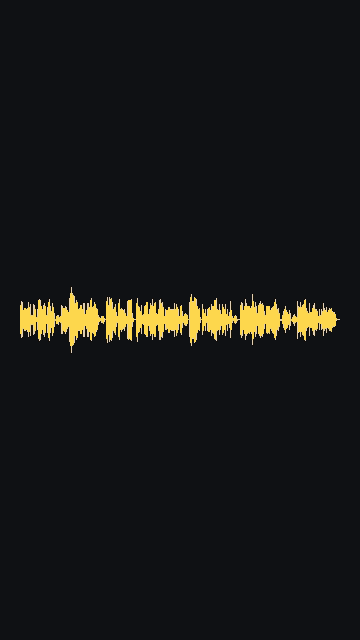

# Demo: a real episode, start to finish

This is a record of running pod2video on a real podcast episode, written so that someone who has never used a terminal can follow along. Everything below actually happened on October 11, 2026, including the mistakes.

**The episode:** "Dr. Beth Harris and Dr. Steven Zucker of Smarthistory" from *Open Minds … from Creative Commons* (25 minutes, licensed [CC BY 4.0](https://creativecommons.org/licenses/by/4.0/)). The hosts gave permission for this demo. The faces in the clips are **cartoon avatars generated from a text description**, not photos, which pod2video supports for exactly this situation: when you don't have (or don't want to use) a real photo.

**The result:** one finished 29-second clip for **695 Magic Hour credits ($0.83)**, plus 100 credits for the two avatars and about $0.16 of AI costs for picking the moments.



## What you need before starting

1. A Mac or Linux computer with a terminal (on a Mac: the **Terminal** app).
2. pod2video installed, following the README's Quickstart.
3. Three API keys pasted into the `.env` file:
   - **Magic Hour** (does the animation): [magichour.ai/developer](https://magichour.ai/developer?tab=api-keys). You need credits in the account. A clip costs about 600–700.
   - **AssemblyAI** (turns speech into text): [assemblyai.com](https://www.assemblyai.com). New accounts get $50 free.
   - **Anthropic** (picks the best moments): [console.anthropic.com](https://console.anthropic.com). Add $5 of credit; an episode uses about 10 cents.

Every command below is typed into the terminal from inside the `pod2video` folder. If you copied the project to your Documents folder, first type:

```bash
cd ~/Documents/pod2video
```

## Step 1: check that everything is set up

```bash
pod2video doctor
```

What it printed:

```
✓ ffmpeg: /opt/homebrew/bin/ffmpeg
✓ TRANSCRIPTION_API_KEY: set (provider: assemblyai)
✓ LLM: model=claude-opus-5-5, key set
✓ MAGIC_HOUR_API_KEY: Usage-based (Creator), 833 credits/$, 28,634 credits available
```

Four ticks means you're ready. A ✗ tells you which key is missing. It also shows your Magic Hour plan and how many credits you have, so you know what you can afford before you start.

## Step 2: get free previews

This is the step that does most of the work, and it costs no Magic Hour credits. It downloads the episode, writes out everything that was said, picks the six best moments, and makes a preview video of each one using still images instead of animation.

```bash
pod2video run --feed https://anchor.fm/s/4d70d828/podcast/rss --episode smarthistory \
  --host "Beth=desc:art historian, shoulder-length wavy auburn hair, warm smile, dark blue blouse, museum gallery background" \
  --host "Steven=desc:art historian, short grey hair, trimmed grey beard, rectangular glasses, charcoal sweater, museum gallery background" \
  --speakers 4 --preview
```

What the parts mean:

- `--feed` is the podcast's RSS address, and `--episode smarthistory` picks the episode whose title contains that word. (`--episode latest` is the usual choice.)
- `--host` describes each person who will appear on screen. Here `desc:` means "draw a cartoon from this description". If you have a photo, write `--host "Beth=beth.jpg"` instead.
- `--speakers 4` tells the transcription that four people talk in this episode (two hosts and two guests). It helps it tell voices apart.
- `--preview` means "don't spend any Magic Hour credits".

The first time, it asks you a question. The transcription labels voices A, B, C, D, and it has no idea which is which, so it shows you a sample line from each and asks:

```
Which speaker is Beth?  [A/B/C/D]
Which speaker is Steven?  [A/B/C/D]
```

Read the sample lines and answer. Your answer is remembered for this podcast, so you're only asked once.

### What went wrong here (and what to learn from it)

I skipped the question by passing `--speaker-map "A=Eric,B=Ony"`, guessing that A and B were the podcast's two hosts. They weren't. A was the host, but B and D were the two *guests*, and the second host barely spoke. Every preview was labelled with the wrong name. **Read the sample lines; don't guess.**

It also meant the interesting people in this episode were the guests, not the hosts. So I re-ran it with Beth and Steven as the on-screen people and `--speaker-map "B=Beth,D=Steven"`. Whoever does the talking in the best moments is who you should put on screen.

Re-running cost nothing extra for the transcription (it's saved), but the moment-picking ran again because the names changed: 8 cents.

### What it printed

```
Transcript: 3,904 words, 25.0 min
                        Candidate clips (speaker-cut layout, prompted mode)
┏━━━┳━━━━━━━━┳━━━━━━━━━━━━━━━━━━━━━━━━━━━━━━━━━━━━━━━━━━━━━┳━━━━━━━━┳━━━━━━━━┳━━━━━━┳━━━━━━━━━━━━━━┓
┃ # ┃ Render ┃ Title                                       ┃ Starts ┃ Length ┃ Jobs ┃ Est. credits ┃
┡━━━╇━━━━━━━━╇━━━━━━━━━━━━━━━━━━━━━━━━━━━━━━━━━━━━━━━━━━━━━╇━━━━━━━━╇━━━━━━━━╇━━━━━━╇━━━━━━━━━━━━━━┩
│ 1 │   ✓    │ How a $30 iPod Mic Started Smarthistory     │   3:12 │  28.9s │    1 │          580 │
│ 2 │   ✓    │ Why We Block Textbook Publishers            │   9:42 │  30.0s │    1 │          600 │
│ 3 │   ✓    │ Art History Isn't a Drag                    │  22:39 │  25.9s │    1 │          520 │
│ 4 │   ✓    │ The 16-Year-Old Who Had No Art History      │  11:49 │  28.8s │    1 │          580 │
│ 5 │   ✓    │ Museums Are Artificial Containers           │  17:34 │  29.1s │    1 │          600 │
│ 6 │   ✓    │ Nothing Terrible Happens When Museums Share │  15:02 │  28.2s │    1 │          580 │
└───┴────────┴─────────────────────────────────────────────┴────────┴────────┴──────┴──────────────┘
Previews are free: rendering the 6 ticked clip(s) would be 3,460 credits (~$4.15 on your plan)
...
LLM: $0.08   Transcription: $0.00   Total: $0.08
Time: select_moments 20s, compose 30s (wall 54s)
```

It took under a minute. The six preview videos are in the `out/` folder, inside a folder named after the episode. Open them and watch. The layout, the cuts and the captions are exactly what the finished clip will have; only the face is a still image.

The transcription line says `$0.00` because the episode had been transcribed earlier in the day. The first time, 25 minutes costs about 10 cents.

### Make the avatars first if you're using descriptions

With `desc:` hosts, the previews showed a grey placeholder circle instead of the cartoon, because the cartoon hadn't been drawn yet (drawing it costs credits, and previews are meant to be free). To see the real avatars in the previews, draw them first:

```bash
pod2video avatars --host "Beth=desc:..." --host "Steven=desc:..."
```

That took about a minute and cost 100 credits (50 per person). It's a one-time cost: the avatars are saved and reused for every future episode. One of the two came back with a thin drawn frame around it and an open-mouth smile even though the description asked for a closed mouth. Both were fine in the final clip, but if you don't like an avatar, run the command again with a tweaked description.

## Step 3: render the clip you want

Watch the previews, pick the one(s) you'd post, then run the same command with `--pick` and without `--preview`. I picked clip 1 and set a spending cap:

```bash
pod2video run --feed https://anchor.fm/s/4d70d828/podcast/rss --episode smarthistory \
  --host "Beth=desc:..." --host "Steven=desc:..." --speakers 4 \
  --pick 1 --max-credits 700
```

`--max-credits 700` means: if this would cost more than 700 credits, stop and don't spend anything.

Before spending, it shows the cost and asks:

```
About to run 1 Talking Photo job(s): ~580 credits (~$0.70). Balance: 28,534 credits.
Spend these credits? [y/n]
```

Then:

```
  … clip 1 / Beth: queued
  … clip 1 / Beth: rendering
  ✓ clip 1 / Beth: 695 credits, 102s
  ✓ out/dr-beth-harris-and-dr-steven-zucker-of-smarthistory/clip_01_how-a-30-ipod-mic-started-smarthistory.mp4

Magic Hour: 695 credits ≈ $0.83 on Usage-based (Creator)
Time: animate 102s, compose 6s (wall 114s)
Same run on other plans: Business, annual $0.66, Creator, annual $0.69
```

Two minutes, and the finished clip is in the `out/` folder, ready to post.

### What I learned from the real bill

The estimate said 580 credits; Magic Hour charged **695**. Magic Hour's docs list `prompted` mode at 20 credits per second, but the actual charge was 1 credit per video frame at 24 frames per second, which is 24 per second. pod2video now estimates with 24, so the estimates match the bill. Expect roughly **600–700 credits for a 25–30 second clip**, which is $0.70–$0.85 on a Creator plan.

The output video from Magic Hour was 640×640 pixels, which pod2video scales up to fit the 1080×1920 vertical frame. It looks fine on a phone, which is where these clips get watched.

## Totals for this demo

| What | Cost |
| --- | --- |
| Transcribing 25 minutes (AssemblyAI) | ~$0.10 |
| Picking the moments, run twice (Anthropic) | $0.16 |
| Two cartoon avatars, one-time (Magic Hour) | 100 credits ($0.12) |
| Rendering one 29 s clip (Magic Hour) | 695 credits ($0.83) |
| **Total** | **about $1.20** |

Rendering all six clips would have been about 4,200 credits, around $5.

## If something goes wrong

- **"MAGIC_HOUR_API_KEY is not set"**: open `.env` and check the key is on the right line with no spaces around the `=`.
- **The wrong person's name is on screen**: your speaker answer was wrong. Run again with `--speaker-map "B=Beth,D=Steven"` (using the right letters) and it will overwrite the saved answer.
- **"Magic Hour cannot find a face"**: the photo or avatar doesn't have a clear, front-facing face. Use a different photo or a different description.
- **"not enough credits"** or **"over the budget"**: pick fewer clips with `--pick`, or top up your Magic Hour account.
- **A job failed**: Magic Hour refunds failed jobs. Run the same command again; finished clips are reused, so you only pay for the one that failed.
